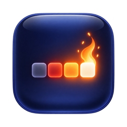
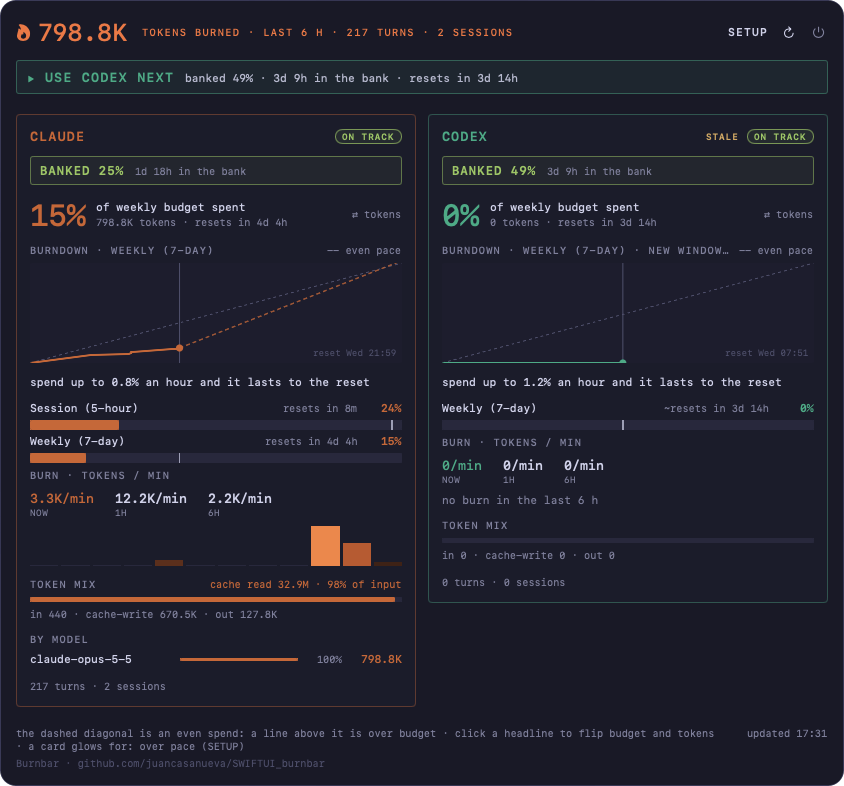
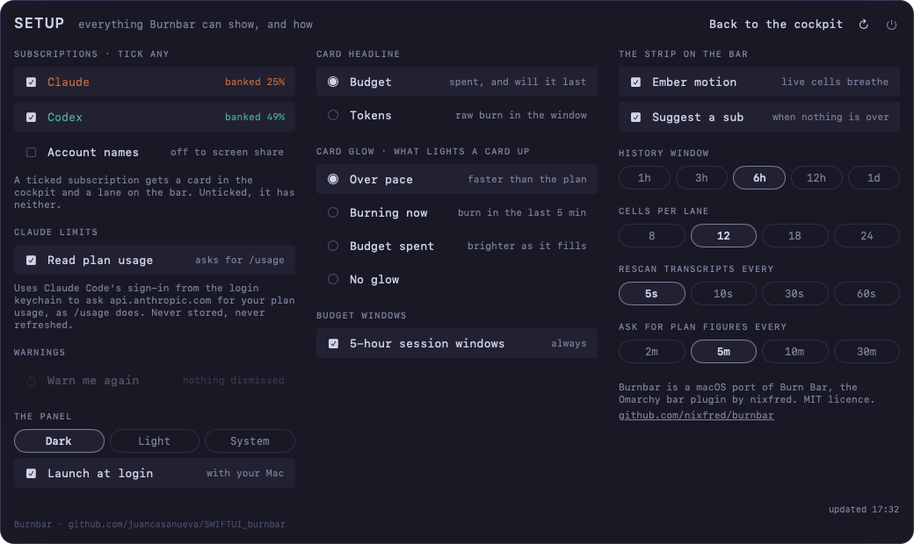

<h1 align="center"> Burnbar</h1>

A native macOS menu bar app that shows how fast you are burning through your Claude and Codex plan limits, and which one to use next.

It is a SwiftUI port of [burnbar](https://github.com/nixfred/burnbar), the Omarchy (Hyprland/Quickshell) plugin by nixfred.

> **Status:** work in progress. See [`odd/tasks/macos-burnbar.md`](odd/tasks/macos-burnbar.md) for the task list and progress.

## Screenshots

**Cockpit**: one card per subscription, with its budget, burndown, windows, burn rate, token mix and models.



**Setup**: every setting, saved across relaunches.



## What it does

- **Heat strip** in the menu bar: one lane per enabled provider, made of heat cells covering a trailing window (6 hours in 12 cells of 30 minutes by default; both are configurable). Colour shows token volume.
- **Ember motion**: live cells breathe with a subtle flicker, and a lane flashes briefly when new burn lands in its latest cell. It can be turned off in Setup and always honours Reduce Motion.
- **Weekly gauges** at the ends of each lane: green, then yellow from 75%, then red from 90%, pulsing at 90% and above.
- **Advice chip**: one recommendation at a time, such as `CLAUDE REST 8H`, `CLAUDE 5-HOUR OUT IN 40M`, `USE CODEX NEXT` or `SPENT`. Click it to dismiss it until things get worse.
- **Cockpit panel**: a wide, dark, monospaced panel with header totals, an advice banner and one card per subscription side by side. Each card has a thin lane-coloured border, a pace verdict (ON TRACK, AT PACE, OVER, WAY OVER), a headline that flips between Budget and Tokens when clicked, a burndown chart, plan windows, burn rates, token mix, usage by model and the signed-in account. Cards glow when they are over pace, burning or spent (configurable).
- **Setup screen**: click SETUP in the cockpit header to open it; "Back to the cockpit" or Esc returns. Settings are saved and survive relaunch:
  - **Subscriptions**: show or hide Claude and Codex (card and lane), and account names (untick for a screen share).
  - **Claude limits**: reading Claude's plan usage.
  - **Warnings**: warn me again, which brings back dismissed advice.
  - **The panel**: theme (dark, light, system) and launch at login. macOS may ask you to approve the login item in System Settings › General › Login Items.
  - **Card headline** (Budget or Tokens), **card glow** (over pace, burning now, budget spent, no glow) and **5-hour session windows** (always, or only near the limit).
  - **The strip on the bar**: ember motion, suggesting the next subscription, history window (1h to 1d), cells per lane (8 to 24), transcript rescan (5s to 60s) and plan figures refresh (2m to 30m).
- **Rate limits**: if Anthropic's usage endpoint is rate-limited, the Claude card keeps showing the last saved reading for windows that have not reset, marked stale, until a fresh one arrives.

burnbar counts tokens; it does not estimate dollar cost. Pace compares the percent of each plan window you have used with the percent of the window that has elapsed.

## Data sources

Everything is read locally except Claude's plan limits.

| What | Source |
| --- | --- |
| Claude token usage | `~/.claude/projects/**/*.jsonl` |
| Codex token usage | `~/.codex/sessions/**/rollout-*.jsonl` |
| Codex plan limits | `rate_limits` in the same Codex session files |
| Claude plan limits | Anthropic's OAuth usage endpoint, using the Claude Code sign-in stored in the Keychain (`Claude Code-credentials`) |
| Account names | `~/.claude.json` and `~/.codex/auth.json` |

macOS may ask once for permission to let burnbar read the Claude Code Keychain item. The token is only sent to Anthropic's API.

## Requirements

- macOS 26.5 or later
- Xcode 26.6 or later to build
- Claude Code and/or Codex CLI installed and signed in

## Install

With Homebrew:

```sh
brew install --cask juancasanueva/tap/burnbar
```

Or download `Burnbar-<version>.zip` from the [latest release](https://github.com/juancasanueva/SWIFTUI_burnbar/releases/latest), unzip it and move `Burnbar.app` to `/Applications`. Releases are signed with Developer ID and notarized by Apple, and run on Apple Silicon.

## Updates

Open Setup and click **Check for Updates…** in the Updates group. Burnbar uses [Sparkle](https://sparkle-project.org) and only installs updates signed with its own key.

Automatic checks are **off by default**: Burnbar does not contact the update feed until you turn on **Automatic checks** in Setup or check by hand. Homebrew installs update the same way (the cask defers to the app).

Maintainers: see [RELEASING.md](RELEASING.md) for how a tag becomes a notarized release, the update feed and the Homebrew cask.

## Build and run

```sh
git clone https://github.com/juancasanueva/SWIFTUI_burnbar.git
cd SWIFTUI_burnbar
open burnbar.xcodeproj
```

Run the `burnbar` scheme. The app has no Dock icon; it appears only in the menu bar.

The App Sandbox is disabled because burnbar needs to read `~/.claude`, `~/.codex` and another app's Keychain item.

## Tests

```sh
xcodebuild -project burnbar.xcodeproj -scheme burnbar -destination 'platform=macOS' test
```

## Architecture

```text
burnbar/
├── App/           App entry point (MenuBarExtra)
├── Domain/        Pure models and math: aggregation, pace, verdicts, advice
├── Data/          Transcript collectors, limits clients, sample store
└── Presentation/  SwiftUI views and observable view models
```

The Domain layer has no I/O and is fully unit tested with Swift Testing.

## Scope

This port covers Claude and Codex. The upstream Grok, Kimi, Zcode and local Ollama/GPU lanes are not included yet.

## License

[MIT](LICENSE). Pace rules, thresholds and lane colours are derived from the original burnbar by nixfred, also MIT licensed.
